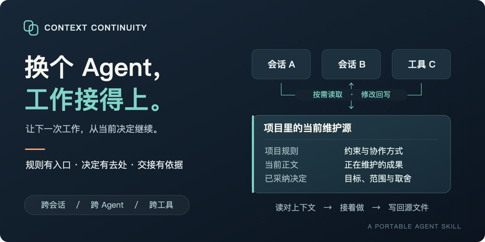
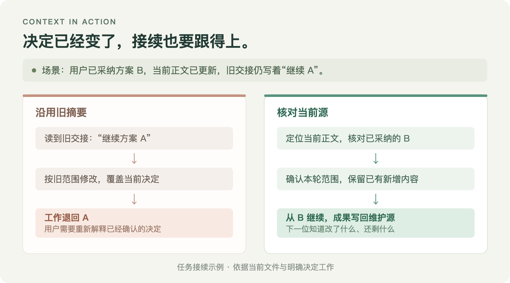

# Context Continuity · 上下文协作治理

**换个 Agent，工作接得上。**

让不同会话、不同工具中的 AI 助手，依据同一项目的当前决定与源文件继续工作。少一次重复解释，多一步有效推进。

**[开始使用](#开始使用) · [下载发布包](https://github.com/JasperLin2333/context-continuity/releases/latest) · [阅读 Skill](SKILL.md) · [参与迭代](CONTRIBUTING.md)**

[](assets/hero.svg)

## 让你已经想清楚的事，成为下一次工作的起点

你和一个 Agent 讨论了很久，终于确定了方案。换个会话、切个工具，新的 Agent 却又从旧版本开始；几个人同时改文件，最后留下的还可能是一份过时摘要。

Context Continuity 把协作中容易丢失的环节落实到项目里：**什么是当前信源，接手时读什么，谁改哪些内容，成果写回哪里。**

它可以用在代码仓库、产品方案、研究文档和持续维护的工作区。沿用你已经在用的规则与目录，把缺口补到真正会被读取的位置。

## 看一次接续，就知道它在解决什么

[](assets/handoff-example.svg)

接续的关键，是打开当前正文、核对最新决定，并把这轮成果写回维护源。交接消息负责告诉下一位从哪里继续，项目文件承载实际成果。

## 四项能力，把上下文变成可执行的协作

| 能力 | 实际帮你做什么 |
| --- | --- |
| **找到当前有效的依据** | 区分规则、导航、当前正文和历史证据；按明确决定识别适用范围，避免凭日期或旧摘要选版本 |
| **把任务交接清楚** | 带上目标、授权、源文件、进度和验证边界；明确各自修改范围与最终回写责任 |
| **保留已经完成的工作** | 修改前核对文件变化，保留用户新增内容；新决定更新维护源，相关入口同步调整 |
| **让重复问题得到针对性修复** | 分清理解、读取、信源、执行和能力缺口，修对应环节，清除冲突与重复规则 |

**按任务大小取上下文，按问题所在改机制。** 一行文案仍然是一行文案的工作量；已有规范足够时直接沿用。一次项目特例留在项目，能复用的方法才进入 Skill。

## 从一个项目开始，也能持续迭代

| 什么时候用 | 直接对 Agent 说 |
| --- | --- |
| **建立** · 新项目要接入多个 AI 工具 | “为这个项目建立最小协作规范，沿用已有文件和目录。” |
| **接续** · 换会话、换工具继续做 | “核对当前源文件、已采纳决定和剩余工作，接着完成这次任务。” |
| **诊断** · 同一个问题反复纠正 | “用这次失败查清问题出在理解、读取还是执行，修复实际缺口。” |
| **迭代** · 已有机制需要改善 | “根据这次反馈修订原有规则，保留有效约束，清除重复与冲突。” |

Skill 负责建立和改进协作机制；日常任务继续通过项目规则与源文件执行。每次真实使用，都可以成为下一次改进的依据。

## 一份方法，面向多种 Agent 平台

通用指令遵循 [Agent Skills 标准](https://agentskills.io/specification)，平台差异在打包时处理。**核心正文只维护一份。**

| 接入方式 | 对应发布包 |
| --- | --- |
| Codex、Claude Code、Cursor、GitHub Copilot 等宿主的 Skill 安装方式 | [标准 Skill 包](https://github.com/JasperLin2333/context-continuity/releases/latest/download/context-continuity.zip) |
| WorkBuddy 开放平台 | [WorkBuddy 包](https://github.com/JasperLin2333/context-continuity/releases/latest/download/context-continuity-workbuddy.zip) |
| 腾讯 SkillHub | [SkillHub 包](https://github.com/JasperLin2333/context-continuity/releases/latest/download/context-continuity-skillhub.zip) |
| Claude 插件与本地 marketplace | [Claude 插件包](https://github.com/JasperLin2333/context-continuity/releases/latest/download/context-continuity-claude.zip) |
| OpenAI Agent Plugins | [OpenAI 插件包](https://github.com/JasperLin2333/context-continuity/releases/latest/download/context-continuity-openai.zip) |

各宿主的安装位置、插件接入方式和能力要求见[平台接入指南](references/platforms.md)。多端协作需要能够访问项目维护源，或使用项目已有的版本同步方式。

## 开始使用

在项目目录中运行，按提示选择你使用的 AI 助手：

```sh
npx skills add JasperLin2333/context-continuity --skill context-continuity
```

也可以直接把这段话发给支持 Skill 安装的 AI 助手：

```text
请安装 https://github.com/JasperLin2333/context-continuity 中的 Skill。
按当前宿主支持的方式安装完整 Skill 及 references。
安装后，先检查这个项目的信源、任务接续和成果回写机制，告诉我最值得优化的地方。
```

然后，从一个具体问题开始：

> 使用 context-continuity，检查这个项目为什么换会话后总会用到旧决定。在已授权范围内优化，保留用户改动，说明实际结果。

**无需新增模型 API Key，执行 Skill 无额外运行依赖，使用你现有的 AI 助手。** 只读分析和文件修改按你的本次要求进行。

## 为长期使用准备的工程底座

| 已有基础 | 可以直接查看的内容 |
| --- | --- |
| **16 项自动化分发测试** | 正文一致性、资源隔离、旧安装保护、独立解压与确定性打包：[测试代码](tests/test_distribution.py) |
| **14 个行为检查场景** | 旧摘要、并发修改、多版本、读取失败与任务恢复等：[场景与预期行为](tests/behavior-cases.md) |
| **5 种发布包** | 同一维护源生成，版本统一注入，随包提供 SHA256 清单：[当前发布](https://github.com/JasperLin2333/context-continuity/releases/latest) |
| **可持续演进的维护结构** | 项目特例、通用方法与平台适配分别归位；版本、检查和发布有明确约定：[迭代规范](CONTRIBUTING.md) |

维护者可以使用 Python 3.10+ 标准库完成检查、构建与安装；仓库提供可选的 [GitHub Actions 模板](templates/github-actions.yml)。欢迎用真实问题来改进它。

<details>
<summary><strong>手动安装与插件接入</strong></summary>

将仓库克隆到本地后，安装到宿主支持的新目录；目标已存在时会保留原安装并停止：

```sh
python3 scripts/distribute.py install --destination "/你的宿主/skills/context-continuity"
```

维护者可加 `--link` 指向同一仓库，前提是宿主支持目录符号链接。

Claude 插件包解压后，在 Claude Code 中添加本地 marketplace 并安装：

```text
/plugin marketplace add /解压目录/context-continuity
/plugin install context-continuity@context-continuity-marketplace
```

OpenAI 插件包按[官方插件文档](https://developers.openai.com/plugins/build/plugins)接入。

</details>

---

**把你的真实问题带过来。** 在 [Issues](https://github.com/JasperLin2333/context-continuity/issues) 描述一次上下文丢失、交接失败或规则冲突；请移除个人信息和业务敏感内容。

方法来自实际项目协作的抽象，参考了 [Orbital](https://github.com/zqiren/Orbital) 的上下文接续与回写思路。采用 [MIT](LICENSE) 许可证，欢迎使用与改进。
